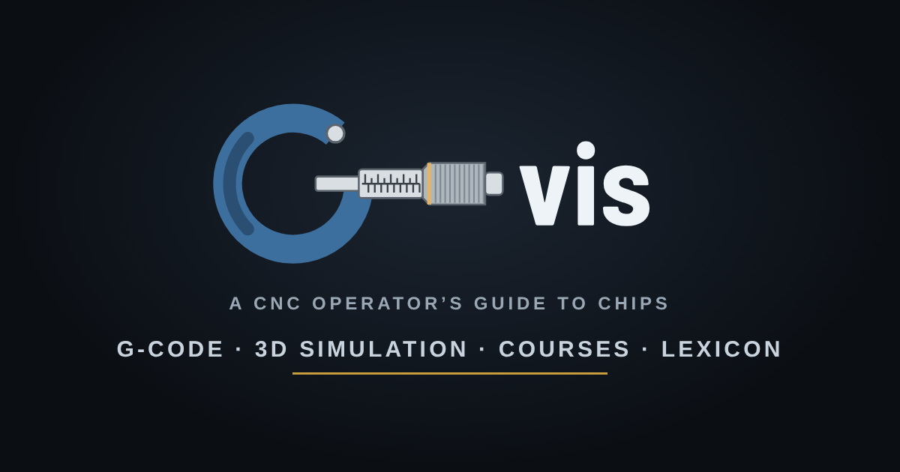

<p align="center">
  
</p>

<h1 align="center">G-vis</h1>

<p align="center">
  <b>A CNC operator's guide to chips.</b><br>
  Write G-code and see the toolpath, the 3D material removal and the physics, in the browser or as a desktop app that works offline.
</p>

<p align="center">
  <a href="https://kcgrabbarna.netlify.app/courses/cnc-gront-kort/g-vis.html"><b>▶ Try G-vis online</b></a>
  &nbsp;·&nbsp;
  <a href="https://github.com/Sharrot83/G-Vis/releases/latest"><b>⬇ Download the app</b></a>
  &nbsp;·&nbsp;
  <a href="https://buymeacoffee.com/sharrot">☕ Buy me a coffee</a>
</p>

---

## What is G-vis?

G-vis is a free G-code visualizer and CNC milling simulator made for learning. You type a program, and G-vis draws the toolpath as you type. In 3D mode it machines a block of stock the way a real machine would. It shows the tools, chips, sound, cutting forces, heat and tool breakage.

It is built for students and teachers in CNC programming, and for anyone who wants to check a program before it goes to a real machine.

G-vis comes with a **tool lexicon** and **simulators** for a vertical mill and two lathes. Everything is available in **English and Swedish**.

## Features

### Code and toolpath
- **Live toolpath** in 2D and 3D: rapids, feed moves, arcs, cutter compensation lead-ins and canned cycles.
- **Explain line:** click any line, and every G code, M code and address on it is explained in plain language, including the cutting speed for the programmed spindle speed.
- **Warnings** for common mistakes: missing feed, compensation on an arc, a cycle that is never cancelled, missing tools and more.
- **Dialects:** Fanuc, Hass, LinuxCNC and ISO (DIN 66025), with a converter that rewrites a program from one dialect to another.
- **Subprograms:** `M98 P… L…` with `M99`, nested up to four levels, and Hass `M97`.
- **Find and replace** in the code, with whole-word matching, so that `G1` does not match `G10` or `G1.5`.

### 3D simulation
- **Material removal** on a heightmap stock, drawn by the graphics card for speed, at three resolutions: Normal, High and Ultra.
- **Physics:** cutting force, torque, spindle power and tool load. The tool breaks if it is overloaded, and the program stops with an explanation.
- **Heat and temper colors** on steel, from straw to blue, along with rubbing, built-up edge and melting plastic.
- **Tool marks** from face mills and end mills.
- **More than 50 materials:** steels, stainless steels, cast irons, aluminum alloys, copper, brass, bronze, titanium and plastics. Each has realistic cutting data and color.
- **Section view, toolpath view** and a **measuring tool** for distance, angle and radius on the machined part.
- **Rotate the part** in 90° steps to machine another side.
- **Tool changer** with 32 pockets, drag and drop, and a library of end mills, face mills, drills, spot drills, taps, chamfer mills and engraving tools.

### Learning
- **13 courses with 78 lessons:**
  1. First moves
  2. Work offsets and G91
  3. Arcs and circles
  4. Cutter compensation
  5. Smooth lead-in and lead-out
  6. Depth and Z
  7. Pocketing
  8. Drilling cycles
  9. Tapping
  10. Cutting data
  11. A real program
  12. Subprograms
  13. Find the error

  Every course starts with a short guide for beginners: what you will learn, what you need to know first and the key words. Every lesson checks your program against a drawing and gives hints that show the method, not the answer.
- **22 practice drawings** (R-01 to R-22), from a straight slot to a complete part, each with a solution.
- **Example programs:** facing, pockets, helical entry, hole patterns, profiles with chamfer, engraving, and a physics demo that ends with a broken cutter.
- **Lexicon:** 35 milling tools, cutting data formulas and calculators, G codes, M codes, address letters, and a step-by-step guide to writing G-code by hand, with a sandbox.

### Simulators
- **Hass mill:** a vertical machining center with a full control panel, handwheel, tool changer, work offsets and the same physics as G-vis.
- **Manual lathe:** a conventional lathe with gearbox, handwheels, compound slide and tailstock.
- **CNC lathe:** a slant-bed lathe with Fanuc-style G-code, canned cycles (G90, G71/G70) and a 12-station turret.

## Getting started

### Online
Open **[G-vis in your browser](https://kcgrabbarna.netlify.app/courses/cnc-gront-kort/g-vis.html)**. You do not need to install anything or create an account. Your code is saved in the browser automatically.

### Desktop app (Windows, macOS, Linux)
Download the latest version from **[Releases](https://github.com/Sharrot83/G-Vis/releases/latest)**:

| System  | File                                    |
|---------|-----------------------------------------|
| Windows | `G-vis_x.y.z_x64-setup.exe` or `.msi`   |
| macOS   | `G-vis_x.y.z_universal.dmg`             |
| Linux   | `.AppImage` or `.deb`                   |

The app contains G-vis, the lexicon and the simulators, and works **without an internet connection**. When a new version is available, the start screen and **Help → About G-vis** say so.

> **Windows:** the app is not code-signed, so the first time it starts Windows may show *"Windows protected your PC"*. Click **More info → Run anyway**.
>
> **macOS:** the first time, right-click G-vis, choose **Open** and confirm.

## Keyboard shortcuts

| Keys                          | Action                                      |
|-------------------------------|---------------------------------------------|
| `Ctrl` + `Enter`              | Draw the G-code                             |
| `Ctrl` + `O` / `S`            | Open / save                                 |
| `Ctrl` + `Shift` + `S`        | Save as                                     |
| `Ctrl` + `F` / `H`            | Find / replace in the code                  |
| `Ctrl` + `M`                  | Tool changer                                |
| `F1`                          | Guide                                       |
| `F11`                         | Full screen                                 |
| `Esc`                         | Close windows, full screen and measuring    |

## Files

G-vis saves ordinary text files (`.nc`, `.gcode`, `.tap`, `.txt` and others). By default it adds one comment line at the top, `(GKODVIZ:SETUP:…)`. That line holds the tool changer, the stock and the material, so they come back when the file is opened again.

- Turn the line off under **File → Save tools, stock and material in the file**.
- Use **File → Save for the machine …** to save the G-code only, ready to send to a real control.

In Chrome and Edge, **Save** writes straight back to the same file. Other browsers download a copy.

## Project structure

This repository also contains other course material. The G-vis parts are:

```
courses/cnc-gront-kort/
├── g-vis.html            G-vis (single page: editor, 2D/3D view, courses, physics)
├── lexikon.html          Tool and G-code lexicon
├── simulator.html        Simulator overview page
├── sim/
│   ├── hass-fras.html    Hass mill simulator
│   ├── svarv.html        Manual lathe and CNC lathe
│   ├── fysik.js          Material physics (heat, oxide colors, surface)
│   ├── material.js       Material library and cutting data
│   ├── ljud.js           Sound engine
│   └── ljud/             Sound files
└── i18n/
    ├── i18n.js           Language engine (Swedish ⇄ English), app mode, version check
    └── en-*.js           English language packs

app/                      Desktop app (Tauri 2)
├── start.html            Start screen of the app
├── build.mjs             Copies the web files into app/dist
├── icon.png              App icon (the build generates all sizes from it)
└── src-tauri/            Rust shell, configuration and permissions

.github/workflows/
└── g-vis-app.yml         Builds the desktop app when a release is published
```

G-vis is plain HTML, CSS and JavaScript, with [three.js](https://threejs.org/) for 3D. It has no build step and no framework, and every library is stored locally, so it runs offline.

## Building the desktop app

You do not need anything installed locally. The app is built by GitHub Actions:

1. Push your changes.
2. Create a new **release** with a tag such as `v1.2.0`. The version number is taken from the tag.
3. The workflow builds installers for Windows, macOS and Linux and attaches them to the release, in about 15–25 minutes.

To build locally instead, install [Rust](https://rustup.rs/) and [Node.js](https://nodejs.org/), then run:

```bash
node app/build.mjs
npx @tauri-apps/cli@2 icon app/icon.png --output app/src-tauri/icons
cd app && npx @tauri-apps/cli@2 build
```

## Languages

The interface is written in Swedish and translated live to English with shop-floor terminology: feed rate, chip load, work offset, cutter compensation, tool changer and so on.

- Switch with the **🌐 English / Svenska** button. The choice is shared between G-vis, the lexicon and the simulators.
- The desktop app starts in the computer's language.
- Example programs get English comments in English mode. Your own code is never changed.

## Support

G-vis is free. If it helps you or your students, you can support the development:

<a href="https://buymeacoffee.com/sharrot">☕ Buy me a coffee</a>

Found a bug or have an idea? Please open an **[issue](https://github.com/Sharrot83/G-Vis/issues)**.

## Disclaimer

G-vis is a learning tool. The simulation and physics are simplified, and the cutting data is guidance only. Always follow the machine manual and the tool manufacturer's recommendations, and prove out new programs carefully on the real machine: single block, reduced rapid and a hand on feed hold.
